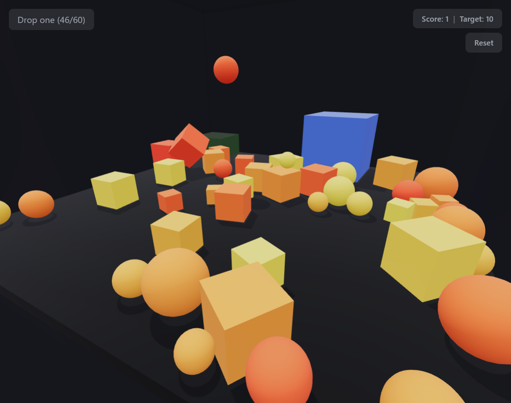

# Physics Toys

A physics playground built with React Three Fiber and Rapier. Drop shapes into an arena, launch them with a click, and get ten of them into the goal to win.

**Live demo:** https://your-app.vercel.app

## How to play

- **Drop one** spawns a random box or ball
- **Click a toy** to launch it away from where you clicked
- **Drag** to orbit the camera, **scroll** to zoom
- Get toys into the green zone: score 10 to win
- **Reset** starts a fresh round

## Features

- Rapier physics: gravity, collisions, friction and bounce
- Each toy spawns with a random size and bounciness, and its colour shows how bouncy it is
- Click-to-launch impulses, scaled by mass so big and small toys feel alike
- Goal zone built from a sensor collider, with no double counting
- Soft shadows, a win screen and a one-click reset
- Toy count capped at 60 (the oldest is removed)

## Tech

React, Vite, Three.js, @react-three/fiber, @react-three/drei, @react-three/rapier, Tailwind CSS. Deployed on Vercel.

## Run locally

    npm install
    npm run dev

## What I learned

- Dynamic vs fixed rigid bodies, and colliders vs meshes
- Why physics bodies own their position instead of React state
- Impulses, and why mass matters
- Sensors and collision events, with `userData` to identify bodies
- Resetting a whole physics world with a `key`
- Shadow setup: renderer, light, shadow camera and meshes

## Roadmap

- [x] Arena with spawning toys
- [x] Click to launch with an impulse
- [x] Goal zone and score
- [x] Shadows, win screen and reset
- [ ] Sound on bounce and goal
- [ ] Moving obstacles (kinematic bodies)
- [ ] Touch-friendly controls

## Credits

Built with [React Three Fiber](https://r3f.docs.pmnd.rs/) and [Rapier](https://rapier.rs/).
